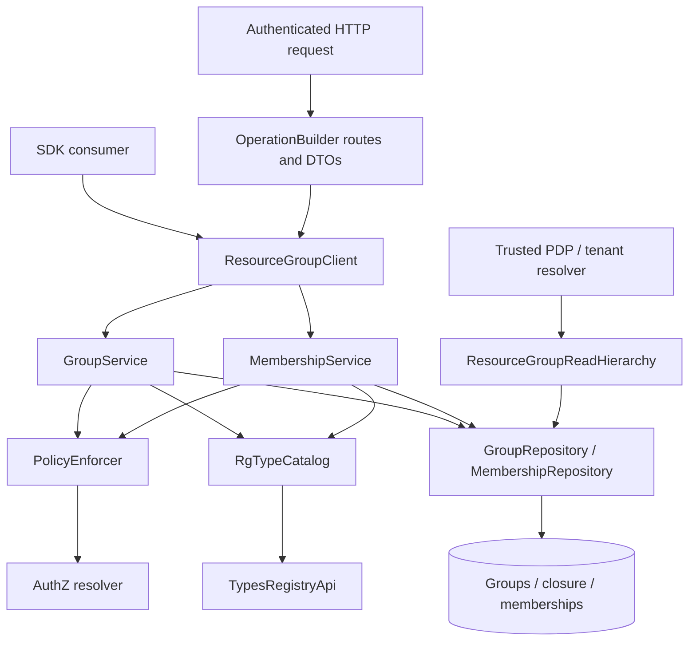
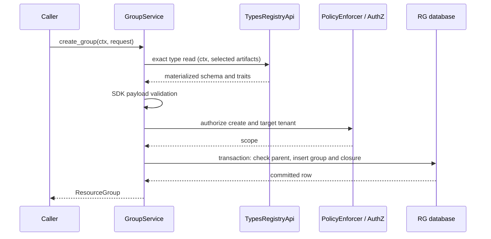

<!-- Created: 2026-04-07 by Constructor Tech -->
<!-- Updated: 2026-11-12 by Constructor Tech -->

# Technical Design - Resource Group (RG)

Resource Group manages a forest of groups and membership links to resources owned
by other gears. Types Registry owns the GTS type definitions that govern group
placement and payload validation. RG persists group instances, their ancestry and
memberships in its own database.

## Contents

- [1. Architecture Overview](#1-architecture-overview)
- [2. Principles & Constraints](#2-principles--constraints)
- [3. Technical Architecture](#3-technical-architecture)
- [4. Runtime and Verification](#4-runtime-and-verification)
- [5. Source References](#5-source-references)

## 1. Architecture Overview

### 1.1 Responsibilities

| Owner | Responsibility |
| --- | --- |
| Resource Group | Group lifecycle, placement checks, cycle prevention, closure-table maintenance, memberships and scoped queries |
| Types Registry | GTS Type Schemas, inheritance, materialized schemas and traits, admission and type lifecycle |
| Declaring gear | Publication of its own RG types before application initialization |
| AuthZ resolver / PDP | Authorization decisions and constraints |
| RG's PolicyEnforcer / SecureORM | Enforcement of those constraints on RG operations and database access |
| Tenant resolver | Interpretation of tenant hierarchy and barrier metadata |

RG exposes two Rust SDK traits through ClientHub:

- `ResourceGroupClient`: authorized group, hierarchy and membership operations.
- `ResourceGroupReadHierarchy`: in-process reads for trusted AuthZ and tenant
  resolver consumers. The consumer owns scoping on this interface.

HTTP routes expose group and membership operations under `/resource-group/v1`.
The host supplies any outer route prefix, such as `/cf`. Type publication and
reads use Types Registry's SDK and API.

### 1.2 Component model



Registry reads and payload compilation precede database write transactions. The
transaction works with the resulting type snapshot and current RG rows. Ordinary
group reads, membership reads and cleanup use stored type identifiers.

### 1.3 Implementation layout

| Location | Contents |
| --- | --- |
| `resource-group-sdk/src/api.rs` | Public SDK traits |
| `resource-group-sdk/src/models.rs` | Group, hierarchy and membership models |
| `resource-group-sdk/src/gts.rs` | RG base schema and placement traits |
| `resource-group-sdk/src/odata/` | Public query fields |
| `resource-group/src/gear.rs` | Configuration, publication, client wiring, migrations and REST composition |
| `resource-group/src/domain/` | Group and membership services, type catalog port, invariants and metrics port |
| `resource-group/src/infra/types_registry.rs` | Types Registry SDK adapter |
| `resource-group/src/infra/storage/` | SecureORM repositories, entities, query mapping and migrations |
| `resource-group/src/api/rest/` | Routes, DTO conversion and canonical error mapping |

## 2. Principles & Constraints

### 2.1 Policy-agnostic data model

- [x] `p1` - **ID**: `cpt-cf-resource-group-principle-policy-agnostic`
- [x] `p1` - **ID**: `cpt-cf-resource-group-constraint-no-authz-decision`
- [x] `p1` - **ID**: `cpt-cf-resource-group-constraint-no-sql-filter-generation`

RG checks graph and membership invariants. The PDP decides who may perform an
operation and returns constraints; PolicyEnforcer and SecureORM apply them.
Consumer-specific authorization policies and barrier interpretation belong to
AuthZ and tenant resolver consumers.

RG's group resource descriptor exposes tenant and resource identifiers. Production
wiring advertises no native group-predicate capability for its own nested groups;
the PDP must expand group scopes into supported predicates or deny the operation.

### 2.2 Forest integrity

- [x] `p1` - **ID**: `cpt-cf-resource-group-principle-strict-forest`

A group has at most one direct parent. Multiple roots are permitted. A move must
preserve an acyclic forest, keep tenant ownership unchanged and satisfy the
moved group's placement rules. Closure rows and the direct parent pointer change
in the same transaction.

The group's GTS type is immutable. `UpdateGroupRequest` carries name, parent and
metadata; it has no type field.

### 2.3 Tenant ownership

- [x] `p1` - **ID**: `cpt-cf-resource-group-principle-tenant-scope-ownership-graph`
- [x] `p1` - **ID**: `cpt-cf-resource-group-principle-tenant-root-uniqueness`

`tenant_type_paths` classifies tenant group types by GTS identifier prefix. The
default is `gts.cf.core.rg.type.v1~cf.core._.tenant.v1~`.

- Creating a tenant-type group opens a tenant scope: `tenant_id = group.id`.
- Other groups are created in an authorized target tenant. A non-tenant child
  must belong to the same tenant as its parent.
- A group retains its tenant when reparented. Cross-tenant moves are refused.
- At most one tenant-type group may be a forest root. Other root types remain
  permitted, subject to their traits.
- A resource identified by `(resource_type, resource_id)` may have memberships
  in several groups of one tenant, but cannot simultaneously belong to groups
  in different tenants.

Target-tenant authorization is enforced by the create path's PolicyEnforcer
constraints. A caller-supplied target does not confer permission to write there.

### 2.4 Registry-owned type contracts

- [x] `p1` - **ID**: `cpt-cf-resource-group-principle-dynamic-types`

An RG type is a GTS Type Schema derived from `gts.cf.core.rg.type.v1~`. RG obtains
its `content`, `resolved_schema` and `effective_traits` from Types Registry.
Placement rules are the materialized traits:

| Trait | Meaning | Base default |
| --- | --- | --- |
| `can_be_root` | Whether a group may have no parent | `false` |
| `allowed_parent_types` | Exact RG type identifiers permitted as direct parents | `[]` |
| `allowed_membership_types` | Exact resource type identifiers permitted as members | `[]` |

Parent types belong to the RG type family. Member resource types may be any
registered GTS type; they need not be RG types. An RG membership records a
resource identifier, and does not prove that the resource instance exists in its
owning gear.

`ResourceGroupTypeTraitsV1::builder()` requires explicit choices for all three
traits and accepts strings for both lists. Registry admission validates authored
types. RG consumes `effective_traits` without reconstructing inheritance or
merging trait defaults itself.

The registry controls evolution of type definitions. RG applies the definition
read for an operation; publication does not scan or rewrite existing RG rows.
There is no distributed transaction between registry publication and an RG write.

### 2.5 Payload and barrier metadata

- [x] `p1` - **ID**: `cpt-cf-resource-group-principle-barrier-as-data`

Type-specific group data is stored in `resource_group.metadata` and returned as
`metadata` in SDK and REST models. Derived GTS schemas constrain that field.
RG validates a domain payload of `{"metadata": ...}` (or `{}` when metadata is
absent) against the unmodified registry snapshot using
`TypeSchema::compile_payload_validator()` from `types-registry-sdk`.

This keeps inherited constraints, references and GTS validation semantics in the
SDK validator. RG does not extract metadata sub-schemas or compile them through
a separate JSON Schema implementation. SDK payload validation itself performs
no registry I/O; target existence checks beyond its documented reference
validation remain separate concerns.

For tenant types, `metadata.self_managed` can express a barrier. RG stores and
returns it without pruning hierarchy queries. Trusted tenant resolver and AuthZ
consumers interpret it according to their own contracts.

### 2.6 Query profiles

- [x] `p1` - **ID**: `cpt-cf-resource-group-principle-query-profile-guardrail`
- [x] `p1` - **ID**: `cpt-cf-resource-group-constraint-profile-change-safety`

`GroupService` receives a `QueryProfile`. Production gear wiring currently uses
`max_depth = Some(10)` and `max_width = None`; these are service guardrails, not
fields of `ResourceGroupConfig`.

Enabled depth and width limits are checked on create and move. Changing a
profile does not rewrite stored groups or closure rows. Each write is evaluated
against the active limits; existing data remains available to reads and cleanup.

### 2.7 Persistence and availability

- [x] `p1` - **ID**: `cpt-cf-resource-group-constraint-db-agnostic`

The implementation supports PostgreSQL and SQLite. Executable migrations and
backend-specific SQL live under `infra/storage/migrations/`. The reference
[schema](migration.sql) describes the current PostgreSQL layout.

RG has no local type-definition mirror or separate type cache. Registry clients
use the public SDK read options. RG's type-definition reads are currently
uncached pending the SDK cache work in Types Registry T36.

Reads and cleanup need the RG database and applicable authorization services;
they do not need a type-definition lookup. Writes that need a type snapshot fail
when that snapshot cannot be obtained. A failed caller read never falls back to
a platform identity.

## 3. Technical Architecture

### 3.1 Domain model

| Model | Representation |
| --- | --- |
| `ResourceGroup` | UUID, GTS type code, name, hierarchy context and optional metadata |
| `GroupHierarchy` | Direct parent UUID and owning tenant UUID |
| `ResourceGroupWithDepth` | Group representation with relative hierarchy depth |
| `ResourceGroupMembership` | Group UUID, resource GTS type identifier and opaque resource ID |
| `RgType` | Operation-local registry snapshot with placement traits and payload schema |
| `GtsTypePath` | SDK value object for validated type identifiers |

A group references another group through `parent_id`. The closure table records
all ancestor/descendant pairs, including `(group, group, 0)`. Memberships attach
resources to groups; group nesting is represented by parent and closure rows.

### 3.2 Components

#### Gear composition

- [x] `p1` - **ID**: `cpt-cf-resource-group-component-gear`

`ResourceGroup` declares database and REST capabilities and publishes the RG SDK
collector through `gts_publication(crates = [resource_group_sdk])`. It consumes
AuthZ and Types Registry SDK contracts. `init` constructs repositories, the
registry adapter, services and the two ClientHub interfaces. It performs no type
registration or remote registry wait.

#### Group and hierarchy operations

- [x] `p1` - **ID**: `cpt-cf-resource-group-component-entity-service`
- [x] `p1` - **ID**: `cpt-cf-resource-group-component-hierarchy-service`

`GroupService` implements lifecycle and subtree operations. `GroupRepository`
implements group and closure persistence together, including scoped reads,
cycle checks, set-based closure maintenance and pagination.

#### Membership operations

- [x] `p1` - **ID**: `cpt-cf-resource-group-component-membership-service`

`MembershipService` authorizes add/remove/list, reads type rules before an add
and enforces tenant ownership inside the insert transaction. Its repository
scopes membership queries through the owning group because the membership table
has no `tenant_id` column.

#### Integration reads

- [x] `p1` - **ID**: `cpt-cf-resource-group-component-integration-read-service`

`RgReadService` implements the trusted `ResourceGroupReadHierarchy` interface.
Its reads bypass PolicyEnforcer to avoid recursing into a PDP that is itself
requesting RG data. Consumers must supply the appropriate filters and validate
tenant ownership. This interface has no separate unscoped HTTP route.

#### Type catalog adapter and repositories

- [x] `p1` - **ID**: `cpt-cf-resource-group-component-persistence-adapter`

`RgTypeCatalog` is a domain port. `RegistryTypeCatalog` implements it over
`TypesRegistryApi`, forwarding the caller's `SecurityContext`. Group payload
reads select `Content`, `ResolvedSchema` and `EffectiveTraits`. Membership rule
reads batch the group type and member resource type and select `EffectiveTraits`;
only the group type is decoded as RG placement traits.

`GroupRepositoryTrait` and `MembershipRepositoryTrait` are injected into services.
Their SecureORM implementations operate on `DBRunner` connections/transactions;
database policy remains with the runtime and PolicyEnforcer.

### 3.3 Startup and declaration ownership

The host runtime starts the system group first. Application database migrations
and registry client wiring precede GTS publication, which completes before
application `init`. RG publishes its base type; gears that use
RG publish their own derived types through their own collectors.

Account Management owns the user-group container
`gts.cf.core.rg.type.v1~cf.core.am.user_group.v1~` and the user member-handle
`gts.cf.core.rg.type.v1~cf.core.am.user.v1~`. They arrive through AM's publication.
Application initialization depends on successful admission of the declarations.
The same declarations are available to the runtime's `publish-gts` deployment
path.

Registry publication can run concurrently across owners. A declaration whose
base is pending is reconciled within the runtime's publication budget. RG
initialization constructs its adapter without making registry requests.

### 3.4 Write flows

#### Create a group

**ID**: `cpt-cf-resource-group-seq-create-entity-with-parent`

1. Validate the requested RG type path and name.
2. Read an active type through the caller's registry API and validate the group
   payload with the SDK validator.
3. Resolve create permissions, target tenant and applicable scope.
4. In a retryable serializable transaction, read the actual parent, check
   placement, tenant rules and profile limits, then insert the group and its
   closure rows.
5. Return the inserted representation.



#### Update or move a group

**ID**: `cpt-cf-resource-group-seq-move-subtree`

The public update path authorizes the caller and reads the existing group under
that scope before returning any type-shaped error. An update supplying non-null
metadata or changing the parent obtains the group's exact type definition before
the transaction. Deleted definitions remain usable because the registry retains
their content. Supplied metadata is validated with the SDK. With an unchanged
parent, renaming or clearing metadata to `null` takes the row-only path and does
not request a type definition.

The transaction re-reads the group and compares its type with the snapshot.
A mismatched type is a conflict. A parent change checks the actual new parent,
cycles, tenant ownership, placement and limits, then updates the parent pointer
and closure rows atomically. Type and tenant ownership remain immutable.

Rename/metadata updates use the backend-default isolation with a row lock.
A parent change uses serializable isolation. If the initial parent snapshot
suggested a row-only update but the transaction observes a parent change, it
returns without writing and retries through the serializable path; any missing
type lookup occurs between transaction attempts.

#### Add a membership

The caller is authorized for membership creation. RG first reads the group under
the membership-derived group scope, then batch-reads the group and resource types
from the registry. Both types must be active, and the group's traits must permit
the resource type.

A retryable serializable transaction rechecks the group's scope and type, checks
for memberships of the resource in other tenants, and inserts the membership.
The tenant check and insert share a transaction to prevent concurrent first
memberships from assigning one resource to two tenants.

#### Delete and cleanup

Non-force group deletion locks its target and refuses groups with child groups
or memberships. Force deletion removes subtree memberships and closure rows and
deletes groups in a safe order inside one serializable transaction. Removing a
membership is a scoped delete by its full key. These operations use the stored
GTS identifiers and do not consult type definitions.

### 3.5 Registry lifecycle and failure behavior

| Operation | Type-definition requirement |
| --- | --- |
| Create group | Active RG type; validate payload and placement |
| Add membership | Active group type and active concrete member resource type; validate allowed memberships |
| Non-null metadata replacement / reparent existing group | Exact RG type definition, deleted included; unknown type is refused |
| Rename or clear metadata with unchanged parent | No registry lookup |
| Group/membership reads and filters | No registry lookup |
| Membership removal / group deletion, including force | No registry lookup |

An unknown or deleted group type is `TypeNotFound` when an active type is
required. An unknown, deleted, malformed, wildcard or instance identifier used as
a new member resource type is a validation error. Caller registry refusals retain
401/403; an unavailable registry is reported as service unavailable. Missing
required projections or undecodable RG traits are internal contract errors. SDK
payload compilation or
validation refusal is a validation error; an absent definition never silently
skips validation on a path requiring one.

### 3.6 Public API

Paths below are relative to the host prefix.

| Method | Path | Operation |
| --- | --- | --- |
| GET | `/resource-group/v1/groups` | Scoped group list |
| POST | `/resource-group/v1/groups` | Create group |
| GET | `/resource-group/v1/groups/{group_id}` | Read group |
| PUT | `/resource-group/v1/groups/{group_id}` | Replace name, parent and metadata |
| DELETE | `/resource-group/v1/groups/{group_id}` | Delete; `force=true` cascades |
| GET | `/resource-group/v1/groups/{group_id}/descendants` | Descendants with relative depth |
| GET | `/resource-group/v1/groups/{group_id}/ancestors` | Ancestors with relative depth |
| GET | `/resource-group/v1/memberships` | Scoped membership list |
| POST | `/resource-group/v1/memberships/{group_id}/{resource_type}/{resource_id}` | Add membership |
| DELETE | `/resource-group/v1/memberships/{group_id}/{resource_type}/{resource_id}` | Remove membership |

The SDK exposes these operations through `ResourceGroupClient`, including
`delete_group_cascade`. Its fallible methods return `CanonicalError`; callers
may project it into `ResourceGroupError` for typed dispatch.

A group response contains `id`, `type`, `name`, `hierarchy.parent_id`,
`hierarchy.tenant_id` and optional `metadata`. Hierarchy responses additionally
include `hierarchy.depth`: self is zero, descendants positive and ancestors
negative. Database timestamps are not part of these response models.

Create accepts an optional UUID and generates one when absent. An optional target
`tenant_id` is subject to create authorization. PUT requires `name`, `parent_id`
and `metadata`; nullable fields must be present as `null` to clear them. PUT
cannot change the group's type.

List endpoints use `limit`, `cursor` and typed OData `$filter`. Group fields are
`id`, `type`, `name`, `tenant_id` and `hierarchy/parent_id`; hierarchy fields are
`type` and `hierarchy/depth`; membership fields are `group_id`, `resource_type`
and `resource_id`. Type predicates support `eq`, `ne` and `in` and compare stored
identifiers. Filtering by an unknown identifier requires no catalog lookup:
it participates in ordinary string comparison. UUID literals can be quoted or
unquoted. Cursor handling and field validation use ToolKit's OData utilities.

The [OpenAPI document](openapi.yaml) and [SDK traits](rust-traits.md) describe the
transport and Rust boundaries respectively.

### 3.7 Persistence model

The RG database contains three domain tables. GTS identifiers are stored as text
in `gts_type_id` with a length constraint of 1–1024 characters. There is no
cross-database FK to Types Registry.

#### `resource_group`

| Column | PostgreSQL type | Meaning |
| --- | --- | --- |
| `id` | UUID, primary key | Group identifier |
| `parent_id` | UUID, nullable | Direct parent; self-table FK |
| `gts_type_id` | TEXT, not null | Group's GTS type identifier |
| `name` | TEXT, not null | Display name, 1–255 characters |
| `metadata` | JSONB, nullable | Type-specific group payload |
| `tenant_id` | UUID, not null | Owning tenant |
| `created_at` | TIMESTAMPTZ | Creation timestamp |
| `updated_at` | TIMESTAMPTZ, nullable | Last update timestamp |

The parent FK uses `ON UPDATE CASCADE` and `ON DELETE RESTRICT`. Indexes cover
`parent_id`, `name`, `tenant_id` and `(gts_type_id, id)`.

#### `resource_group_closure`

| Column | PostgreSQL type | Meaning |
| --- | --- | --- |
| `ancestor_id` | UUID | Ancestor group FK |
| `descendant_id` | UUID | Descendant group FK |
| `depth` | INTEGER | Distance; zero for self, non-negative |

The primary key is `(ancestor_id, descendant_id)`. Both FKs use update cascade
and delete restrict. Indexes on `descendant_id` and `(ancestor_id, depth)` support
walks in either direction. A subtree move rewrites affected ancestry while
retaining its internal subtree relationships.

#### `resource_group_membership`

| Column | PostgreSQL type | Meaning |
| --- | --- | --- |
| `group_id` | UUID | Owning group FK |
| `gts_type_id` | TEXT | Member resource's GTS type identifier |
| `resource_id` | TEXT | Opaque identifier in the owning gear |
| `created_at` | TIMESTAMPTZ | Creation timestamp |

The primary key is `(group_id, gts_type_id, resource_id)`. The group FK uses update
cascade and delete restrict. `(gts_type_id, resource_id)` supports reverse lookup.
Tenant scoping is enforced through the owning group.

SQLite uses its backend representation for UUIDs, timestamps and JSON while
preserving the same relationships and indexes. Migrations are the executable
source of truth for each backend. PostgreSQL B-tree entry-size limits also apply
to membership keys: accepted type length alone does not guarantee that an
arbitrarily long resource identifier fits in an index entry.

## 4. Runtime and Verification

### 4.1 Transactions and concurrency

All multi-statement writes use bounded transaction retries for transient database
failures. The isolation level follows the invariant being protected:

| Write | Isolation / locking |
| --- | --- |
| Group create, reparent, subtree force delete | Serializable |
| Rename or metadata update without reparenting | Backend default with target row lock |
| Non-force group delete | Backend default with target row lock |
| Membership add and cross-tenant ownership check | Serializable |
| Membership removal | One scoped delete statement |

Registry I/O and payload compilation run outside write transactions. Group type
snapshots are rechecked against actual group rows inside the transaction. Profile,
parent, cycle and tenant checks that depend on database state use that transaction's
rows. Database retries reuse the operation's registry snapshot; they do not fetch
types while a transaction is held open.

### 4.2 Errors and observability

The boundary returns canonical error envelopes mapped to RFC 9457 HTTP problems.
Missing or out-of-scope groups and memberships are indistinguishable. Validation
failures, state preconditions, duplicate rows, authorization refusals, transient
registry failures and internal database failures retain distinct categories.
Raw database diagnostics are logged server-side rather than exposed to callers.

`RgMetricsPort` records write outcomes, operation latency, closure work, payload
validation duration and isolation escalation. The gear installs the OpenTelemetry
adapter; services constructed without it use the no-op recorder. Metrics for a
retried operation are recorded outside the retry closure.

### 4.3 Tests

| Layer | Evidence |
| --- | --- |
| SDK contract | `resource-group-sdk/src/gts_tests.rs`, model and error projection tests; trait builder compile-fail examples |
| Registry adapter | `resource-group/src/infra/types_registry_tests.rs`: projections, caller forwarding, lifecycle, SDK validation of inherited schemas/references |
| Real admission | `resource-group/tests/managed_types_admission_test.rs`: persisted registry/outbox, declared base and derived types, effective traits and SDK payload validation |
| Domain and REST | `group_service_test`, `membership_service_test`, `api_rest_test`, `tenant_filtering_db_test`, `registry_types_test` |
| Database behavior | `db_behavior_audit_test`, `query_recorder_test`, membership tenant isolation tests |
| Backend migration | SQLite and PostgreSQL type-identifier migration tests: row preservation, constraints, indexes and rollback on refusal |
| PostgreSQL concurrency | `pg_smoke_test`, `pg_concurrency_test` with the `integration` feature |
| End-to-end | `testing/e2e/suites/resource_group` and Account Management's existing suite |

Focused commands from the repository root:

```bash
cargo test -p cf-gears-resource-group-sdk
cargo test -p cf-gears-resource-group
cargo test -p cf-gears-account-management --lib gts::rg_types
RG_PG_REQUIRE_DOCKER=1 cargo test -p cf-gears-resource-group --features integration \
  --test pg_migration_gts_type_identifiers_test --test pg_smoke_test --test pg_concurrency_test
make e2e-local SUITE=resource_group
```

The E2E suite publishes fixture types through Types Registry's platform API,
waits for admission and exercises group/membership routes through the real host.

## 5. Source References

- [Gear composition](../resource-group/src/gear.rs)
- [Group service](../resource-group/src/domain/group_service.rs)
- [Membership service](../resource-group/src/domain/membership_service.rs)
- [Registry adapter](../resource-group/src/infra/types_registry.rs)
- [SDK payload validator](../../types-registry/types-registry-sdk/src/payload.rs)
- [Executable migrations](../resource-group/src/infra/storage/migrations/)
- [Current PostgreSQL schema](migration.sql)
- [Rust SDK interfaces](rust-traits.md)
- [OpenAPI](openapi.yaml)
- [Authorization architecture](../../../../docs/arch/authorization/DESIGN.md)
- [Resource group authorization model](../../../../docs/arch/authorization/RESOURCE_GROUP_MODEL.md)
